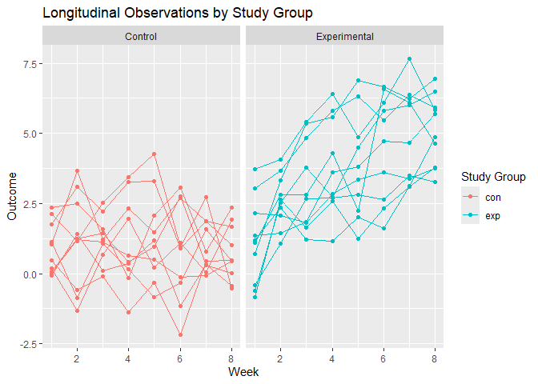

P8105 Homework 5
================
Wenda Yoanda

## Problem 1: Birthday Simulation

In this problem, I use simulation to estimate the probability that at
least two people share a birthday in a group.

### Simulation Function and Results

I created a function to check for shared birthdays and ran 10,000
simulations for each group size from 2 to 50.

``` r
birthday_repeated = function(n_people) {
  birthdays = sample(1:365, size = n_people, replace = TRUE)
  repeated_birthday = length(unique(birthdays)) < n_people
  return(repeated_birthday)
}

birthday_results =
  expand_grid(
    n_people = 2:50,
    iter = 1:10000
  ) |>
  mutate(
    repeated = map_lgl(n_people, birthday_repeated)
  )

birthday_summary =
  birthday_results |>
  group_by(n_people) |>
  summarize(
    prob_repeat = mean(repeated)
  )

birthday_repeated(5)
```

    ## [1] FALSE

``` r
birthday_repeated(23)
```

    ## [1] FALSE

``` r
birthday_repeated(50)
```

    ## [1] TRUE

``` r
head(birthday_results, 10)
```

    ## # A tibble: 10 × 3
    ##    n_people  iter repeated
    ##       <int> <int> <lgl>   
    ##  1        2     1 FALSE   
    ##  2        2     2 FALSE   
    ##  3        2     3 FALSE   
    ##  4        2     4 FALSE   
    ##  5        2     5 FALSE   
    ##  6        2     6 FALSE   
    ##  7        2     7 FALSE   
    ##  8        2     8 FALSE   
    ##  9        2     9 FALSE   
    ## 10        2    10 FALSE

``` r
birthday_summary
```

    ## # A tibble: 49 × 2
    ##    n_people prob_repeat
    ##       <int>       <dbl>
    ##  1        2      0.0018
    ##  2        3      0.0098
    ##  3        4      0.0155
    ##  4        5      0.0281
    ##  5        6      0.0383
    ##  6        7      0.057 
    ##  7        8      0.0736
    ##  8        9      0.0934
    ##  9       10      0.122 
    ## 10       11      0.137 
    ## # ℹ 39 more rows

The simulation results show that the probability of at least two people
sharing a birthday increases as the group size increases. For a group of
2 people, the estimated probability is 0.18%, compared with 2.81% for 5
people and 12.25% for 10 people.

### Probability Plot

The plot below shows how the probability of sharing a birthday changes
as the group size increases.

``` r
birthday_summary |>
  ggplot(aes(x = n_people, y = prob_repeat)) +
  geom_point() +
  geom_line() +
  labs(
    title = "Probability of Shared Birthdays",
    x = "Number of People",
    y = "Probability of Shared Birthday"
  )
```

<!-- -->

The plot shows a nonlinear increasing relationship, with the probability
reaching approximately 50% at a group size of 23 people and approaching
100% as the group size increases toward 50.

## Problem 2: Longitudinal Study

In this problem, I use iteration to import longitudinal data from
multiple participants and organize the observations into a tidy
dataframe.

### Data Import and Tidying

The code below reads the participant files and organizes the data by
subject, study group, and week.

``` r
full_df =
  tibble(
    files = list.files("data/", pattern = "\\.csv$"),
    path = str_c("data/", files)
  ) |>
  mutate(
    data = map(path, read_csv)
  ) |>
  unnest(data)

tidy_df =
  full_df |>
  mutate(
    files = str_replace(files, "\\.csv$", ""),
    group = str_sub(files, 1, 3)
  ) |>
  pivot_longer(
    week_1:week_8,
    names_to = "week",
    values_to = "outcome",
    names_prefix = "week_"
  ) |>
  mutate(
    week = as.numeric(week)
  ) |>
  select(
    group,
    subj = files,
    week,
    outcome
  )

head(tidy_df, 10)
```

    ## # A tibble: 10 × 4
    ##    group subj    week outcome
    ##    <chr> <chr>  <dbl>   <dbl>
    ##  1 con   con_01     1    0.2 
    ##  2 con   con_01     2   -1.31
    ##  3 con   con_01     3    0.66
    ##  4 con   con_01     4    1.96
    ##  5 con   con_01     5    0.23
    ##  6 con   con_01     6    1.09
    ##  7 con   con_01     7    0.05
    ##  8 con   con_01     8    1.94
    ##  9 con   con_02     1    1.13
    ## 10 con   con_02     2   -0.88

### Spaghetti Plot

The following plot shows how each participant’s outcome changes over the
eight weeks, allowing us to compare the control and experimental groups.

``` r
tidy_df |>
  ggplot(
    aes(
      x = week,
      y = outcome,
      group = subj,
      color = group
    )
  ) +
  geom_point() +
  geom_path() +
  facet_grid(
    ~group,
    labeller = as_labeller(
      c(con = "Control", exp = "Experimental")
    )
  ) +
  labs(
    title = "Longitudinal Observations by Study Group",
    x = "Week",
    y = "Outcome",
    color = "Study Group"
  )
```

<!-- -->

The spaghetti plot shows that the control and experimental groups have
different patterns over time. In the control group, outcomes remain
relatively stable across the eight weeks, although there are some
fluctuations between participants. In the experimental group, outcomes
generally increase over time. There are also differences in outcomes
among participants within each group. Overall, the experimental group
shows a greater increase in outcomes compared to the control group.
