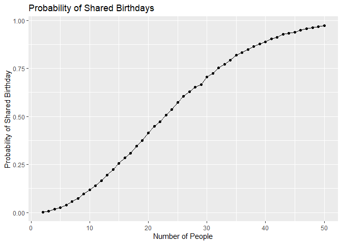

P8105 Homework 5
================
Wenda Yoanda

## Problem 1: Birthday Simulation

In this problem, I use simulation to estimate the probability that at
least two people share a birthday in a group.

### Simulation Function and Results

I created a function to check for shared birthdays and ran 10,000
simulations for each group size from 2 to 50.

``` r
birthday_repeated = function(n_people) {
  birthdays = sample(1:365, size = n_people, replace = TRUE)
  repeated_birthday = length(unique(birthdays)) < n_people
  return(repeated_birthday)
}

birthday_results =
  expand_grid(
    n_people = 2:50,
    iter = 1:10000
  ) |>
  mutate(
    repeated = map_lgl(n_people, birthday_repeated)
  )

birthday_summary =
  birthday_results |>
  group_by(n_people) |>
  summarize(
    prob_repeat = mean(repeated)
  )

birthday_repeated(5)
```

    ## [1] FALSE

``` r
birthday_repeated(23)
```

    ## [1] TRUE

``` r
birthday_repeated(50)
```

    ## [1] TRUE

``` r
head(birthday_results, 10)
```

    ## # A tibble: 10 × 3
    ##    n_people  iter repeated
    ##       <int> <int> <lgl>   
    ##  1        2     1 FALSE   
    ##  2        2     2 FALSE   
    ##  3        2     3 FALSE   
    ##  4        2     4 FALSE   
    ##  5        2     5 FALSE   
    ##  6        2     6 FALSE   
    ##  7        2     7 FALSE   
    ##  8        2     8 FALSE   
    ##  9        2     9 FALSE   
    ## 10        2    10 FALSE

``` r
birthday_summary
```

    ## # A tibble: 49 × 2
    ##    n_people prob_repeat
    ##       <int>       <dbl>
    ##  1        2      0.0023
    ##  2        3      0.0067
    ##  3        4      0.017 
    ##  4        5      0.0262
    ##  5        6      0.0397
    ##  6        7      0.0563
    ##  7        8      0.0741
    ##  8        9      0.0957
    ##  9       10      0.118 
    ## 10       11      0.138 
    ## # ℹ 39 more rows

The simulation results show that the probability of at least two people
sharing a birthday increases as the group size increases. For a group of
2 people, the estimated probability is 0.23%, compared with 2.62% for 5
people and 11.77% for 10 people.

### Probability Plot

The plot below shows how the probability of sharing a birthday changes
as the group size increases.

``` r
birthday_summary |>
  ggplot(aes(x = n_people, y = prob_repeat)) +
  geom_point() +
  geom_line() +
  labs(
    title = "Probability of Shared Birthdays",
    x = "Number of People",
    y = "Probability of Shared Birthday"
  )
```

<!-- -->

The plot shows a nonlinear increasing relationship, with the probability
reaching approximately 50% at a group size of 23 people and approaching
100% as the group size increases toward 50.
